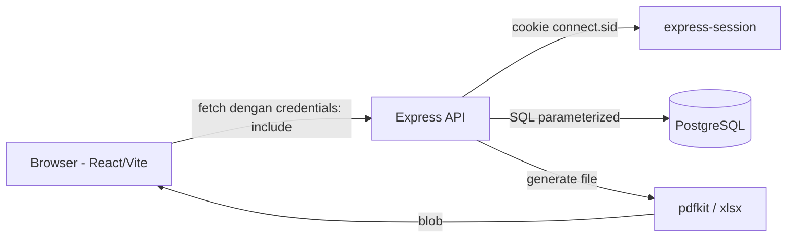
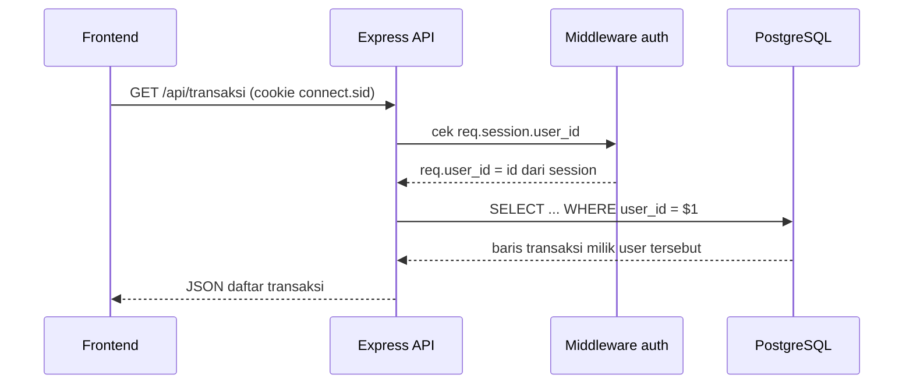

# Laporan Pelaksanaan Proyek: Sistem Pengelolaan Keuangan Pribadi Berbasis Web Menggunakan React.js

## 1. Pendahuluan

### 1.1 Latar belakang

Pencatatan keuangan pribadi sering kali masih dilakukan secara manual sehingga sulit untuk memantau pemasukan, pengeluaran, dan batas anggaran. Aplikasi web dapat membantu proses tersebut dengan menyimpan data terpusat, membatasi akses per pengguna, serta menyajikan ringkasan yang mudah dibaca. Proyek ini dibangun untuk memenuhi tugas akhir dengan menerapkan React.js di sisi frontend dan Express–PostgreSQL di sisi backend.

### 1.2 Tujuan

- Membangun aplikasi web yang dapat mencatat pemasukan dan pengeluaran per pengguna.
- Menyediakan autentikasi berbasis session cookie dengan password ter-hash.
- Menampilkan dashboard bulan berjalan beserta **Batas Total** pengeluaran bulanan dan alert saat terlampaui.
- Menghasilkan laporan transaksi dalam format PDF dan Excel.
- Menyusun dokumentasi yang mudah dipahami untuk keperluan laporan kuliah.

### 1.3 Ruang lingkup

Aplikasi mencakup registrasi/login, CRUD transaksi, pengelolaan kategori, batas total pengeluaran bulanan (bisa diedit), dashboard, dan ekspor laporan. Tidak termasuk fitur multi-role, transfer antar pengguna, notifikasi email, atau deployment produksi.

## 2. Teknologi yang digunakan

| Komponen | Pilihan | Alasan singkat |
|---|---|---|
| Frontend | React 19 + Vite 8 | Komponen UI, state, dan `useEffect` untuk pengambilan data |
| Backend | Express 4 (JavaScript, ESM) | Ringan dan sesuai untuk REST API |
| Database | PostgreSQL 16 | Relasional, mendukung constraint, agregasi, dan UPSERT |
| Akses DB | `pg` | Query SQL langsung dengan parameter `$1`, `$2`, ... |
| Autentikasi | `express-session` + `bcrypt` | Session cookie `httpOnly`, password tidak disimpan plain |
| Laporan | `pdfkit`, SheetJS `xlsx` 0.20.3 | PDF buatan server dan workbook Excel |
| Infrastruktur | Docker Compose | Menjalankan db, backend, frontend bersama |

## 3. Desain sistem

### 3.1 Arsitektur umum



### 3.2 Alur permintaan terproteksi



`user_id` tidak pernah diambil dari body atau query. Dengan demikian pengguna tidak dapat membaca, mengubah, atau menghapus data pengguna lain.

### 3.3 Skema database

| Tabel | Kolom utama | Keterangan |
|---|---|---|
| `users` | `id`, `nama`, `email` UNIQUE, `password`, `created_at` | Password berupa hash bcrypt |
| `kategori` | `id`, `nama`, `tipe` (`masuk`/`keluar`), `grup` (`Harian`/`Urgent`/NULL) | 6 kategori awal + 1 kategori khusus `__BATAS_TOTAL__` |
| `transaksi` | `id`, `user_id`, `kategori_id`, `tipe`, `nominal > 0`, `tanggal DATE`, `catatan` | `user_id` REFERENCES users, cascade on delete |
| `anggaran` | `id`, `user_id`, `kategori_id`, `bulan CHAR(7)`, `batas > 0` | UNIQUE `(user_id, kategori_id, bulan)`; dipakai juga untuk batas total per bulan |

Kategori awal: Gaji, Uang Saku (`masuk`); Makan, Transport (`keluar`, Harian); Belanja, Hiburan (`keluar`, Urgent). Kategori `__BATAS_TOTAL__` disembunyikan dari form transaksi dan dipakai sebagai satu baris batas total per user per bulan (default Rp 1.000.000).

### 3.4 Konfigurasi dan keamanan

- Semua konfigurasi sensitif dibaca dari environment variable (`config.js`), contoh ada di `.env.example`.
- CORS memakai `origin: CORS_ORIGIN` dan `credentials: true`.
- Cookie session: `httpOnly: true`, `sameSite: 'lax'`, `secure` mengikuti `COOKIE_SECURE`.
- `req.session.regenerate()` dipanggil setelah register/login untuk mencegah *session fixation*.
- Pesan error login sengaja seragam untuk email salah maupun password salah.
- Seluruh query memakai parameter, bukan konkatenasi string.

## 4. Pelaksanaan delapan langkah

### Langkah 1 — Struktur proyek dan database

**Tujuan:** menyiapkan fondasi direktori, infrastruktur, dan skema database.

**Dibuat:** `docker-compose.yml` (3 service), `.env.example`, `.gitignore`, `db/init.sql`, folder kosong `backend/` dan `frontend/`.

**Hasil:** 4 tabel dan 6 kategori awal terdefinisi; `init.sql` di-mount ke entrypoint PostgreSQL; volume `db-data` dan healthcheck `pg_isready` tersedia.

### Langkah 2 — Backend dasar

**Tujuan:** membuat server Express dengan koneksi `pg`, konfigurasi lingkungan, CORS, dan health check.

**Dibuat/diubah:** `backend/src/index.js`, `config.js`, `db.js`, `routes/health.js`, `package.json`.

**Hasil:** `/api/health` mengembalikan 200 saat database tersambung dan 503 saat tidak; endpoint tidak dikenal mengembalikan JSON 404; header CORS dan `credentials` benar. Sesuai aturan proyek, health check juga berada di belakang middleware `auth`.

### Langkah 3 — Autentikasi dan session

**Tujuan:** registrasi, login, logout, dan proteksi endpoint.

**Dibuat/diubah:** `routes/auth.js`, `middleware/auth.js`, `index.js`.

**Hasil:** password di-hash bcrypt dengan 10 ronde; session dibuat ulang setelah login; logout menghancurkan session dan menghapus cookie. Pengujian dengan PostgreSQL embedded: **16 dari 16 pemeriksaan lulus**, termasuk isolasi pesan error dan invalidasi session setelah logout.

### Langkah 4 — Frontend dasar

**Tujuan:** menyiapkan React/Vite dan halaman pertama.

**Dibuat/diubah:** `frontend/` scaffold, `src/main.jsx`, `App.jsx`, `components/Header.jsx`, `pages/Beranda.jsx`, `index.css`, `Dockerfile`.

**Hasil:** `npm run build` berhasil, dev server merespons 200, dan JSX ter-transform. Scaffold Vite lama di root tidak diubah.

### Langkah 5 — Form login React

**Tujuan:** menghubungkan form login ke API memakai state React.

**Dibuat/diubah:** `pages/Login.jsx`, `App.jsx`.

**Hasil:** `useState` menyimpan input, `onSubmit` mengirim `fetch` dengan `credentials: 'include'`, dan `App` menyimpan data pengguna. Uji browser: password salah menampilkan pesan 401; password benar menampilkan "Selamat datang, Mahasiswa Uji"; logout mengembalikan ke form.

### Langkah 6 — CRUD transaksi

**Tujuan:** mengelola data transaksi dengan `useEffect` dan *list rendering*.

**Dibuat/diubah:** `routes/transaksi.js`, `routes/kategori.js`, `pages/Transaksi.jsx`, `App.jsx`, `index.css`, `index.js`.

**Hasil:** GET/POST/PUT/DELETE semuanya memfilter `user_id` dari session; frontend memuat transaksi dan kategori saat halaman dibuka, merender tabel dengan `.map()`, dan memakai satu form untuk tambah/edit. Perbaikan penting: `tanggal::text` dipakai di query karena `pg` mengembalikan `DATE` sebagai ISO string.

**Verifikasi:** tanpa session 401; 6 kategori; nominal 0 ditolak 400; POST 201; user kedua mendapat 404 saat GET/PUT/DELETE data user pertama. Uji browser: tambah `75.000`, edit menjadi `80.000`, hapus hingga baris hilang; urutan request GET → POST → GET → PUT → GET → DELETE → GET, tanpa error console.

### Langkah 7 — Dashboard dan batas total

**Tujuan:** merangkum keuangan bulan berjalan dan memberi peringatan saat total pengeluaran melebihi batas.

**Dibuat/diubah:** `routes/dashboard.js`, `routes/anggaran.js`, `utils/batasTotal.js`, `components/AlertAnggaran.jsx`, `components/BatasTotal.jsx`, `pages/Dashboard.jsx`, `pages/Beranda.jsx`, `App.jsx`, `index.css`, `index.js`, `db/init.sql`.

**Hasil:** dashboard menampilkan total masuk/keluar/saldo dan pengeluaran per kategori (grup Harian/Urgent, tanpa batas per kategori). Batas total disimpan satu baris per user per bulan lewat kategori khusus `__BATAS_TOTAL__` (default Rp 1.000.000); tombol **Edit Batas** meng-update baris bulan yang sama. Alert tampil sebagai `Melebihi batas Rp ...` saat terlampaui dan hilang otomatis saat batas aman.

**Verifikasi:** API embedded Postgres lulus skenario: default `1000000/1000000/[]`, pengeluaran 1.200.000 → `-200000 ["Melebihi batas Rp 200.000"]`, edit ke 1.500.000 → aman, turun ke 1.000.000 → alert lagi; `/api/kategori` tidak memuat `__BATAS_TOTAL__`. Uji browser: Edit Batas 1.500.000 menampilkan sisa Rp 300.000, turun ke 1.000.000 menampilkan alert; 0 error console.

### Langkah 8 — Laporan PDF dan Excel

**Tujuan:** mengunduh laporan transaksi bulanan.

**Dibuat/diubah:** `utils/bulan.js`, `routes/laporan.js`, `routes/dashboard.js` (refactor helper), `index.js`, `package.json`, `components/UnduhLaporan.jsx`, `pages/Dashboard.jsx`, `index.css`.

**Hasil:** PDF berisi judul, bulan, ringkasan, dan daftar transaksi; Excel berisi sheet **Ringkasan** dan **Transaksi**. Filter bulan memakai query parameter opsional `?bulan=YYYY-MM` dengan default bulan berjalan. Frontend mengunduh file sebagai blob agar cookie session tetap ikut.

**Verifikasi:** tanpa session 401; format bulan salah 400; PDF 200 `application/pdf` dengan magic `%PDF`; Excel 200 dengan magic `PK`; user kedua menerima PDF lebih kecil dan tidak memuat catatan user pertama. Uji browser menghasilkan `laporan-transaksi-2026-11.pdf` (1.521 byte) dan `.xlsx` (17.678 byte). `npm audit` menunjukkan 0 kerentanan setelah memakai SheetJS dari situs resminya.

## 5. Hasil pengujian keseluruhan

| No | Pengujian | Diharapkan | Hasil |
|---|---|---|---|
| 1 | Skema `init.sql` | 4 tabel, 6 kategori | ✅ |
| 2 | Compose | 3 service, init.sql ter-mount, healthcheck ada | ✅ |
| 3 | `/api/health` tanpa DB / dengan DB | 503 / 200 | ✅ |
| 4 | Endpoint tidak dikenal | JSON 404 | ✅ |
| 5 | Autentikasi (register, login, error, logout, session) | 16/16 lulus | ✅ |
| 6 | Endpoint tanpa cookie | 401 | ✅ |
| 7 | Validasi nominal 0 dan batas 0 | 400 | ✅ |
| 8 | Isolasi data antar pengguna | 404 untuk user lain | ✅ |
| 9 | CRUD browser (tambah, edit, hapus) | 201 / 200 / 200 | ✅ |
| 10 | Batas total & alert | default 1jt, alert saat terlampaui, edit naik/turun benar | ✅ |
| 11 | Laporan PDF dan Excel | file valid, unduh berhasil | ✅ |
| 12 | Build frontend | sukses, 24 modul | ✅ |
| 13 | `npm audit` backend | 0 kerentanan | ✅ |
| 14 | Error console browser | tidak ada | ✅ |

Docker tidak tersedia di mesin pengembangan, sehingga pengujian database memakai `embedded-postgres` sementara pada port 5433, backend 5001, dan Vite 5173. Seluruh server dan tab browser uji dimatikan setelah pengujian.

## 6. Kendala dan solusi

| Kendala | Solusi |
|---|---|
| `pg` mengembalikan kolom `DATE` sebagai string ISO lengkap (`2026-11-20T17:00:00.000Z`) | Menambahkan `tanggal::text` pada SELECT dan RETURNING |
| Otomasi browser sulit mengisi `<input type="date">` | Mengisi segmen Day/Month/Year dengan `press` sesuai urutan |
| Docker tidak tersedia untuk uji integrasi | Memakai PostgreSQL embedded dengan skema `init.sql` yang sama |
| Paket `xlsx` di npm memiliki advisory keamanan | Memasang rilis resmi SheetJS 0.20.3 dari CDN |
| Backend uji kadang belum siap saat browser dibuka | Menunggu respons 404 dari endpoint dummy sebelum interaksi |
| Vite proxy lama mengarah ke port backend salah saat uji | `vite.config.js` proxy `/api` mengikuti `VITE_API_URL`/env fallback 5000 |

## 7. Kesimpulan dan saran

Delapan langkah pengerjaan telah selesai: dari struktur proyek, backend, autentikasi, frontend, CRUD transaksi, dashboard/anggaran, hingga ekspor laporan. Aplikasi memenuhi kebutuhan dasar pencatatan keuangan per pengguna dan dapat dijalankan baik dengan Docker Compose maupun secara manual. Pengujian API dan browser menunjukkan hasil sesuai harapan, dengan tidak ada error console.

Untuk pengembangan selanjutnya, disarankan memakai store session persistence (database/Redis) untuk produksi, menambahkan pagination pada daftar transaksi, serta pengujian otomatis (unit/integration test) agar perubahan berikutnya lebih aman.

## 8. Daftar file proyek

```text
keuangan-pribadi/
├── README.md
├── LAPORAN.md
├── docs/API.md
├── docker-compose.yml
├── .env.example
├── .gitignore
├── db/init.sql
├── backend/
│   ├── Dockerfile
│   ├── package.json
│   └── src/
│       ├── index.js
│       ├── config.js
│       ├── db.js
│       ├── middleware/auth.js
│       ├── utils/
│       │   ├── bulan.js
│       │   └── batasTotal.js
│       └── routes/
│           ├── auth.js
│           ├── health.js
│           ├── transaksi.js
│           ├── kategori.js
│           ├── dashboard.js
│           ├── anggaran.js
│           └── laporan.js
└── frontend/
    ├── Dockerfile
    ├── index.html
    ├── package.json
    ├── vite.config.js
    └── src/
        ├── main.jsx
        ├── App.jsx
        ├── index.css
        ├── components/
        │   ├── Header.jsx
        │   ├── AlertAnggaran.jsx
        │   ├── BatasTotal.jsx
        │   └── UnduhLaporan.jsx
        └── pages/
            ├── Login.jsx
            ├── Beranda.jsx
            ├── Transaksi.jsx
            └── Dashboard.jsx
```

Dokumentasi teknis endpoint ada di [`docs/API.md`](docs/API.md), sedangkan panduan instalasi dan konfigurasi ada di [`README.md`](README.md).
